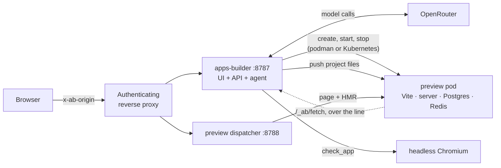

# apps-builder

A self-hosted app builder: describe an app in a chat, an AI agent plans it, designs it and writes it,
and the app runs in a live preview beside the conversation. In the spirit of Lovable or Bolt, but on your
own machine or Kubernetes cluster, with any model available on [OpenRouter](https://openrouter.ai).

It is a personal, single-user project, released continuously since September 2026 (see
[CHANGELOG.md](CHANGELOG.md)). Most of it was built with Claude Code: the majority of its commits are
co-authored by Claude.

## What it does

- **Asks before it guesses.** When a request leaves product decisions open, the agent asks
  (`ask_user`), then writes a spec and a step-by-step plan. It builds one step at a time, and you choose
  when it stops.
- **Design first, if you want.** It asks a few design questions, draws three designs to pick from,
  writes the chosen one down as the app's `DESIGN.md`, and holds every later change to it.
- **Live preview with hot reload.** Each project runs in its own pod (a Vite + React + Tailwind
  template) on its own host name; the page updates as the agent writes files.
- **Full-stack apps.** An app that needs shared data gets a server, PostgreSQL and Redis (`add_service`).
- **Checks its own work.** `check_app` typechecks the project, opens it in headless Chromium at a chosen
  screen size, clicks and types through steps, reads the page back, and can ask a vision model a question
  about it ("is the Greet button readable?"). Pick a text-only model and it proposes one that can see,
  to describe the screenshots in words for it.
- **Every turn is a git commit.** The history tab restores any checkpoint; edits made by hand in the code
  pane are commits too.
- **Shows its work.** Streamed reasoning, a live line of what the agent is doing, a per-file diff for each
  change, a log of every step, and the token cost of each request.
- **A gallery of projects,** each with a screenshot of its last run. Idle previews stop on their own.

## How it works



- **The server** (`server/`) is Bun + [Hono](https://hono.dev). It serves the client, the API and the
  agent loop: `agent.ts` runs a turn with the [AI SDK](https://ai-sdk.dev) and its OpenRouter provider,
  `prompt.ts` holds the builder's instructions and `tools.ts` its tools (`list_files`, `read_file`,
  `write_file`, `edit_file`, `delete_file`, `check_app`, `add_service`, `ask_user`, `save_spec`,
  `update_plan`, and the design phase's `ask_design`, `write_design`, `save_design_md`). The model's
  stream reaches the browser as server-sent events (`stream.ts`).
- **The client** (`src/`) is React + Vite + Tailwind, with CodeMirror for the code pane.
- **Previews** run one pod per project, from one pod spec (`pod.ts`) and two backends (`backend.ts`):
  rootless Podman beside the server (`podman.ts`, `podman kube play`), or, when `AB_PREVIEW_NAMESPACE`
  is set, Kubernetes pods created through the API with the gVisor runtime and a volume for the app's
  databases (`kube.ts`). A pod's `/app` starts empty: apps-builder pushes the project into it, then every
  change (`sync.ts`).
- **Outbound requests from an app** (a feed reader, a weather card) don't leave the pod directly: they go
  through `/_ab/fetch`, which apps-builder relays over a long-polled line it holds into the pod
  (`line.ts`, `fetch-relay.mjs`), refusing private, loopback and link-local addresses. On Kubernetes the
  preview pods are meant to have no network egress at all.

### Security model

apps-builder has no login of its own: it expects to sit behind a reverse proxy that authenticates the user.

- **Every request, on both ports, must carry `x-ab-origin: <AB_ORIGIN_SECRET>`,** which the proxy adds
  after login (`server/origin.ts`, compared in constant time). Without the header the answer is 403; with
  `AB_ORIGIN_SECRET` unset, every answer is 503: a missing setting takes the service down rather than
  opening it.
- **Previews live on another origin** (`<slug>.<AB_PREVIEW_DOMAIN>`). The dispatcher also checks an
  `ab_preview` cookie (`AB_PREVIEW_SECRET`), which the UI obtains from `POST /api/session`, and strips the
  cookie and the origin header before the request reaches the app.
- **Generated code is untrusted.** On Kubernetes it runs under gVisor, as a restricted pod without a
  service-account token.

## Running it locally

**Needs:** Bun ≥ 1.4, Node (Vite's launcher uses it), git, rootless Podman, and Playwright's Chromium
headless shell for `playwright-core` 1.63.0, which apps-builder uses but never downloads:
`npx playwright@1.63.0 install --only-shell chromium`.

```bash
bun install

# The preview image: Node and the template's node_modules. Again whenever template/bun.lock changes.
podman build -f deploy/preview.Dockerfile \
  --build-arg AB_LOCK=$(sha256sum template/bun.lock | cut -d' ' -f1) \
  -t localhost/apps-builder-preview:dev .

export OPENROUTER_API_KEY=…            # the model gateway
export AB_ORIGIN_SECRET=$(openssl rand -hex 32)
export AB_PREVIEW_SECRET=$(openssl rand -hex 32)

bun run dev     # API on :8787 (restarts on change), Vite on :5173 (proxies /api)
```

Then open http://localhost:5173 with the header `x-ab-origin: $AB_ORIGIN_SECRET` on every request: a
browser extension that adds request headers is enough to try it, and any reverse proxy does it for real
(Caddy: `reverse_proxy 127.0.0.1:5173 { header_up x-ab-origin {env.AB_ORIGIN_SECRET} }`). Projects are
stored in `~/Deployments/apps-builder/projects` unless `AB_PROJECTS_DIR` says otherwise. Editing `server/`
restarts the API, which stops the running previews until their next Start.

## Configuration

`AB_` stands for apps-builder.

| Variable | What it is | Default |
|---|---|---|
| `OPENROUTER_API_KEY` | Key for the model gateway | required: unset, every message answers 503 |
| `AB_ORIGIN_SECRET` | The value the proxy puts in `x-ab-origin` | required: unset, everything answers 503 |
| `AB_PREVIEW_SECRET` | The value of the `ab_preview` cookie that admits a browser to the previews | required for previews |
| `AB_PREVIEW_DOMAIN` | Previews are served at `<slug>.<this domain>` (a wildcard DNS name) | unset: `http://127.0.0.1:<port>/` |
| `COOKIE_DOMAIN` | Domain of that cookie, so the preview frame on another subdomain sends it (e.g. `.apps.example.net`) | unset: the API's own host only |
| `AB_PREVIEW_NAMESPACE` | Kubernetes namespace for preview pods; set, previews run there (gVisor) instead of Podman | unset: Podman |
| `AB_PREVIEW_IMAGE` | The preview image (`deploy/preview.Dockerfile`) | `localhost/apps-builder-preview:dev` |
| `AB_BROWSER_CDP` | A Chromium to drive over CDP for `check_app` and screenshots (e.g. a sidecar at `http://127.0.0.1:9222`) | unset: launched locally |
| `AB_PROJECTS_DIR` | Where projects are stored | `~/Deployments/apps-builder/projects` |
| `PORT` | UI and API | `8787` |
| `PREVIEW_PORT` | Preview dispatcher | `8788` |
| `VITE_PORT` | Vite dev server for the UI | `5173` |
| `AB_DEV_HOST` | Public host name of a dev instance behind a TLS proxy, so Vite's hot reload connects over `wss://` on 443 | unset |
| `GIT_SHA` | The commit a deployed image runs, shown in the About screen | `git rev-parse HEAD` |

Inside a preview pod, apps-builder itself sets `AB_API`, `AB_CONTROL_TOKEN`, `DATABASE_URL` and
`REDIS_URL` for the app and its control script (`pod.ts`).

## Tests and releases

- `bun run test`: the unit and integration checks that need no running server (`bun test`, ~25 s).
- `bun run check`: the build, those tests, then `scripts/check-preview.ts` end to end against a real
  server, real preview pods and Chromium (~5 min).
  It also fails when `CHANGELOG.md`, `package.json` and the server disagree on the version.
- `bun run typecheck`.
- `bun run release <major|minor|patch|X.Y.Z>`: the only way a version happens; it tags one from
  `CHANGELOG.md`'s `[Unreleased]` section.

`deploy/` holds the two images (`Dockerfile`: the server with Chromium beside it; `preview.Dockerfile`)
and their tests. The author's deployment builds and tests both on every tag, then rolls them out to a
Kubernetes cluster through GitOps, reverting on its own when a rollout fails.

## Layout

| Path | What it holds |
|---|---|
| `server/` | API, agent loop, tools, preview backends, dispatcher, sync, screenshots, design phase |
| `src/` | The client: chat, code pane, preview, gallery, settings |
| `shared/` | Code both sides run: slugs, settings, labels, diffs, OpenRouter's model catalog |
| `template/` | The starting point of every generated app (Vite + React + React Router + TanStack Query + Tailwind) |
| `test/` | `bun test` checks |
| `scripts/` | The end-to-end check suite, a browser smoke test, the catalog refresh, the release |
| `deploy/` | The server and preview images and their tests |
